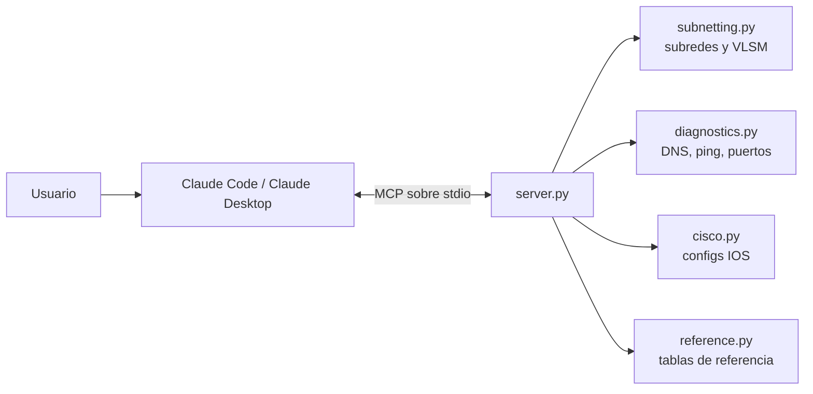

# netops-mcp

[](https://github.com/ivanTt30/netops-mcp/actions/workflows/ci.yml)


Servidor **[Model Context Protocol (MCP)](https://modelcontextprotocol.io)** que da a Claude herramientas reales de redes: **subredes y VLSM, diagnóstico de conectividad y configuración Cisco IOS**.

> *"Diseña la red de un instituto a partir de 192.168.20.0/24 con una VLAN para alumnos (100 equipos) y otra para profesores (40), y dame la configuración del switch y del router con DHCP."*

En lugar de calcular "de cabeza" (y arriesgarse a fallar), Claude llama a herramientas deterministas, validadas y testeadas.

## Características

### 🛠️ Tools

| Tool | Qué hace |
|---|---|
| `calcular_subred` | Red, máscara, wildcard, broadcast, rango de hosts y tipo (privada, pública, APIPA…) |
| `comprobar_ip_en_red` | Si una IP pertenece a una red y si es de red, broadcast o host utilizable |
| `dividir_vlsm` | Reparte una red entre varias subredes con VLSM |
| `resolver_dns` | Resuelve un dominio a IPv4/IPv6 |
| `hacer_ping` | Alcanzabilidad, % de pérdida y latencia (Linux, macOS y Windows) |
| `comprobar_puerto` | Puerto TCP abierto, cerrado o filtrado |
| `generar_config_switch` | Config IOS de VLANs, puertos de acceso y trunk 802.1Q, por pasos |
| `generar_config_router` | Router-on-a-stick con subinterfaces 802.1Q y DHCP, por pasos |

Todas devuelven **salida estructurada** (JSON Schema generado con Pydantic) e incluyen *annotations* MCP (`readOnlyHint`, `openWorldHint`).

### 📚 Resources

| URI | Contenido |
|---|---|
| `netops://referencia/puertos` | Tabla de puertos bien conocidos |
| `netops://referencia/cidr` | Chuleta CIDR de /8 a /32 |
| `netops://subred/{ip}/{prefijo}` | Plantilla: datos de cualquier subred |

### 💬 Prompts

| Prompt | Uso |
|---|---|
| `disenar_red` | Diseño completo: VLSM → VLANs → switch → router |
| `diagnosticar_conectividad` | Diagnóstico por capas: DNS → ping → puerto TCP |

## Arquitectura



La lógica de red está **separada** del protocolo: los módulos son Python puro y se prueban por separado. `server.py` solo los publica como tools, resources y prompts.

```
netops-mcp/
├── src/netops_mcp/
│   ├── server.py        # Servidor MCP: tools, resources y prompts
│   ├── subnetting.py    # Subredes, VLSM y pertenencia de IPs
│   ├── diagnostics.py   # DNS, puertos TCP y ping (con validación de entradas)
│   ├── cisco.py         # Generadores de configuración Cisco IOS
│   └── reference.py     # Tablas de referencia
├── tests/               # Tests de la lógica y del protocolo MCP
└── examples/            # Clientes MCP de ejemplo
```

## Instalación

Requisitos: **Python 3.12+** y **[uv](https://docs.astral.sh/uv/)**.

```bash
git clone https://github.com/ivanTt30/netops-mcp.git
cd netops-mcp
uv sync
```

### Probarlo desde la terminal

```bash
uv run python examples/cliente.py
uv run python examples/recursos.py
```

### Usarlo con Claude Code

```bash
claude mcp add --scope user netops -- uv --directory /ruta/a/netops-mcp run netops-mcp
```

### Usarlo con Claude Desktop

Añade esto a `claude_desktop_config.json` y reinicia Claude Desktop:

```json
{
  "mcpServers": {
    "netops": {
      "command": "uv",
      "args": ["--directory", "/ruta/a/netops-mcp", "run", "netops-mcp"]
    }
  }
}
```

## Ejemplos de uso

- *"¿Qué rango de hosts tiene 172.16.5.9/20?"*
- *"¿Puedo asignar la 192.168.1.191 a un PC de la red 192.168.1.128/26?"*
- *"¿Mi equipo tiene salida a Internet? Haz ping a 1.1.1.1 y comprueba el puerto 443 de github.com."*
- *"Crea las VLAN 10 ALUMNOS y 20 PROFESORES, con Fa0/1-12 en la 10, Fa0/13-24 en la 20 y trunk por Gi0/1."*

## Seguridad

- **Sin inyección de comandos:** los hosts se validan (IP o nombre según RFC 1123) y `ping` se ejecuta con una lista de argumentos, nunca a través de una shell.
- **Límites:** como máximo 10 paquetes de ping y 10 segundos de timeout.
- **Las tools de Cisco solo generan texto:** no se conectan a ningún equipo.
- **Entradas validadas con Pydantic:** rangos de VLAN, puertos, número de hosts…
- Hay tests específicos que comprueban que los intentos de inyección se bloquean.

## Desarrollo

```bash
uv sync
uv run pytest          # tests
uv run ruff check .    # linter
uv run ruff format .   # formato
```

Los tests del protocolo conectan un cliente MCP **en memoria** al servidor, así que no necesitan red ni Claude.

## Hoja de ruta

- [ ] Subredes IPv6
- [ ] Generador de ACLs estándar y extendidas
- [ ] Configuración de OSPF y rutas estáticas
- [ ] Publicación en PyPI

## Autor

**Ivan Tercero Barrios**, estudiante del CFGS de Telecomunicaciones (Sevilla).
Proyecto creado para poner en práctica el curso de Model Context Protocol de Anthropic.

## Licencia

[MIT](LICENSE)
